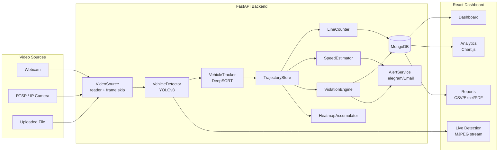

# System Architecture

## High-Level Flow

## Component Responsibilities

| Component | File | Responsibility |
|-----------|------|-----------------|
| `VideoSource` | `app/services/video_source.py` | Unified webcam/RTSP/file reader, frame-skip, reconnect |
| `VehicleDetector` | `app/services/detector.py` | YOLOv8 inference, filtered to vehicle classes |
| `VehicleTracker` | `app/tracking/tracker.py` | DeepSORT, assigns permanent track IDs |
| `TrajectoryStore` | `app/tracking/trajectory.py` | Path history, object lifetime, direction |
| `LineCounter` | `app/services/line_counter.py` | Virtual entry/exit line crossing counts |
| `SpeedEstimator` | `app/services/speed_estimator.py` | Pixel-displacement speed + overspeed flag |
| `ViolationEngine` | `app/violations/detector.py` | Wrong-direction, lane, red-light, U-turn, no-parking |
| `HeatmapAccumulator` | `app/services/heatmap.py` | Traffic density grid + color overlay |
| `AlertService` | `app/services/alerts.py` | Rate-limited Telegram/email dispatch |
| `DetectionSession` | `app/services/detection_session.py` | Orchestrates the full per-frame pipeline in a background thread |
| `analytics_service` | `app/services/analytics_service.py` | MongoDB aggregation for dashboards/reports |
| `report_generator` | `app/services/report_generator.py` | CSV/Excel/PDF export |

## Threading Model

Each detection session (one camera/video) runs its own daemon thread, because
OpenCV frame reads, YOLO inference, and DeepSORT matching are all blocking,
CPU/GPU-bound calls that would freeze FastAPI's async event loop if run
directly on it. The API layer only touches thread-safe shared state (a lock
around the latest annotated frame + stats) to serve requests. This is what
makes multi-camera support work: N cameras = N independent threads, not N
requests competing for one event loop.

Detection threads write to MongoDB through a synchronous `pymongo` client
(`app/core/database.get_sync_database`), separate from the async `Motor`
client used by normal request handlers — the two clients point at the same
database, they're just suited to different execution contexts.

## Data Flow Per Frame

1. `VideoSource` yields a frame (honoring `frame_skip`)
2. `VehicleDetector.detect()` returns raw detections (class, confidence, bbox)
3. `VehicleTracker.update()` matches detections to persistent track IDs
4. For each tracked vehicle: `TrajectoryStore` records its centroid,
   `SpeedEstimator` computes speed, `LineCounter` checks for a crossing,
   `ViolationEngine` runs configured rule checks, `HeatmapAccumulator` adds
   a density sample
5. Violations and crossings persist to MongoDB; alert-worthy events go
   through `AlertService` (rate-limited per camera+condition)
6. The frame is annotated (boxes, trails, counting line, stats overlay) and
   JPEG-encoded for the MJPEG stream
